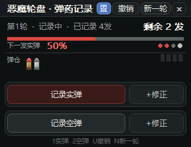

# 恶魔轮盘 · 弹药记录器

记录 *Buckshot Roulette（恶魔轮盘）* 每一轮里还剩几发**实弹**、几发**空弹**，并实时算出
**下一发是实弹的概率**。纯 Win32 API 手写，单文件、免安装，**内存占用极低**。

> Windows 10 / 11 桌面小工具 · C + Win32 API · 52 KB · 私有内存 1.6 MB · 空闲 CPU 0



## 特性

- **记录模型**：先设定本轮弹药总数，之后每打一发点一次「记录实弹 / 记录空弹」，剩余数自动扣减
- **实时概率**：按 `剩余实弹 ÷ 剩余总数` 计算下一发实弹概率，并画出比例条
- **随时撤销**：撤销按钮 / 右键窗口 / `U` / `Ctrl+Z` / `Ctrl+Alt+Z`
- **轮次管理**：新一轮面板内置常用预设（2/2、3/2、3/3、4/2、4/3）与 ± 步进器；本轮打完自动弹出
- **全局热键**：`Ctrl+Alt+S` 实弹、`Ctrl+Alt+D` 空弹、`Ctrl+Alt+Z` 撤销、`Ctrl+Alt+R` 清零，游戏全屏时同样有效
- **弹仓图示**：手绘子弹图标（红弹头 + 黄铜弹壳 = 实弹，灰白弹壳 = 空弹），并显示已发射格与射击序列
- **窗口置顶**、可拖动、自动记忆位置；配置存 `settings.ini`，绿色便携
- **无依赖**：不需要 .NET / VC++ 运行库，也不使用任何 Windows 控件（界面全部 GDI 手绘）

## 下载使用

1. 到 [Releases](../../releases) 下载 `BuckshotCounter.exe`
2. 双击运行，无需安装（建议放在任意文件夹里，配置会存在同目录的 `settings.ini`）

也可以直接克隆仓库，运行仓库根目录里的 `BuckshotCounter.exe`。

## 操作说明

| 操作 | 说明 |
| --- | --- |
| **记录实弹 / 记录空弹**（大按钮） | 记一发：该类型剩余 −1、总数 −1、概率自动更新 |
| **+修正** | 该类型剩余 +1（点错时补回来） |
| **撤销** / **右键窗口** / `U` / `Ctrl+Z` | 撤销上一发记录 |
| 鼠标滚轮 | 指针停在「实弹」行：上滚记一发、下滚补回；空弹行同理 |
| `N` / **新一轮** | 打开弹药设置面板（范围 0–16，预设一键选中） |
| 键盘 | `1` 记实弹、`2` 记空弹、`Esc` 关面板 / 退出 |
| 全局热键 | `Ctrl+Alt+S` / `D` / `Z` / `R` |
| `置` / `×` | 窗口置顶开关 / 退出 |

## 资源占用

| 项目 | 实测值 |
| --- | --- |
| 文件体积 | 53,760 字节（约 52.5 KB，单文件） |
| 私有内存（Private Bytes） | **1.6 MB** |
| 工作集（任务管理器「内存」列） | 约 11 MB，其中绝大部分是系统 GDI/USER 共享页面 |
| 空闲 CPU | 0（纯消息驱动，无定时器、无轮询） |
| 线程 / 句柄 | 4 / 108（长时间运行不增长） |
| 外部依赖 | 仅系统自带 `kernel32 / user32 / gdi32 / msvcrt` |

## 自己编译

需要 MinGW-w64（`gcc` + `windres`，Windows 上可用 MSYS2 / Scoop 安装）。

```bat
build.bat
```

脚本流程：编译 `make_icon.c` 生成 `app.ico` → `windres` 编译 `app.rc`（图标 / 版本信息 / 清单）
→ `gcc -O2 -s -mwindows -static` 链接出 `BuckshotCounter.exe`。

> `build.bat` 里默认写的是本机 MinGW 路径 `C:\MinGW\mingw64\bin`，路径不同时改一下前面两行 `set CC=` / `set RC=`。
> 仓库也带了 GitHub Actions（`.github/workflows/build.yml`），推送到 `main` 后会自动用 MSYS2 的 MinGW-w64 编译并上传产物。

源码只有 `buckshot_counter.c` 一个文件（约 800 行，含中文注释），几个关键点：

* 界面全部用 `CreateFontW` / `DrawTextW` / `RoundRect` / `FillRect` / `BitBlt` 双缓冲手绘，**不使用任何控件**，因此无闪烁；
* 子弹图标是按像素画的（弹头梯形 + 弹壳竖直渐变 + 高光 + 描边），不需要位图资源；
* 只在 `WM_PAINT` 时工作，其余时间线程挂在 `GetMessageW` 上，所以 CPU 恒为 0；
* 不用 C 运行库的字符串 / 格式化函数，静态链接 `-O2 -s` 剥离符号，所以体积只有 52 KB。

## 配置格式

正常退出后会在 exe 同目录写入 `settings.ini`：

```ini
round=2
live_total=3
blank_total=2
fired_live=1
fired_blank=0
all_live=7
all_blank=5
done=1
shots=LLBLLBL      ; 本轮射击序列（L=实弹 B=空弹），撤销用
x=693
y=80
topmost=1
hotkeys=1
```

放在只读目录（如 `C:\Program Files`）时配置无法保存，但功能不受影响。

## 许可证

[MIT](LICENSE)
